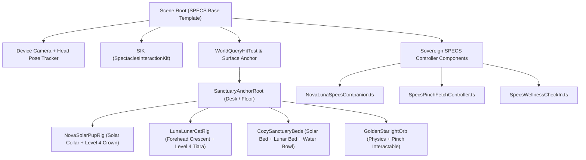

# 🏗️ System Architecture: Lens Studio 5.22+ & Spectacles Interaction Kit (SIK)

**Workflow:** `challengepost/learn-specs` (`plan-lens` Stage 2)  
**Target SDK:** Lens Studio `5.22+` · Spectacles Interaction Kit (`SIK`) · TypeScript `@component`

---

## 1. Scene Hierarchy (Lens Studio 5.22+ SPECS Base Template)

---

## 2. TypeScript Component Responsibilities (`Assets/Scripts/`)

### 2.1 [`NovaLunaSpecsCompanion.ts`](../Assets/Scripts/NovaLunaSpecsCompanion.ts)
- Manages the **Twin Companion Lifecycle** on Snap OS:
  - Surface placement via `WorldQueryModule` (supports both **Desk Mode** `scale = 0.45` and **Room Floor Mode** `scale = 1.0`).
  - **12-second Autonomous Cozy Bed Return** (`CALM_IDLE_THRESHOLD_SEC = 12.0`), Solar Sphinx-Curl (`0.28m -> 0.145m`), Lunar Cat-Loaf (`0.24m -> 0.09m`), and Twin Synergy Harmonic Thread (`432Hz + 528Hz`).
  - **Persistent 4-Tier Bond Progression** (`KeyValueStore` / `PersistentStorageSystem`) unlocking the 3D Sovereign Solar & Celestial Crowns.

### 2.2 [`SpecsPinchFetchController.ts`](../Assets/Scripts/SpecsPinchFetchController.ts)
- Connects `SIK.HandInputData` pinch events to deterministic ballistics and autonomous fetch:
  - Index-thumb pinch grabs the Golden Orb (near-pinch `<= 10cm` or ray-pinch `<= 2.5m`).
  - Pinch release transfers smoothed hand velocity (`80ms` ring buffer) into `AIRBORNE_FLIGHT`, clamping inside the SPECS play radius (`1.8m`).
  - Evaluates open-palm qualification (`handY >= 0.45m`, `horizontalDist <= 0.85m`, `!isPinching`, `palmNormalY > 0.15`) so Nova places the orb directly onto the wearer's open hand.

### 2.3 [`SpecsWellnessCheckIn.ts`](../Assets/Scripts/SpecsWellnessCheckIn.ts)
- Hands-Free Accessibility & Proactive Agentic Wellness for Spectacles wearers:
  - **`1.1s` Gaze-Dwell Activation** with `180ms` head-tremor grace decay.
  - **100% Voice-Command Parity** (`"Nova fetch"`, `"Give treat"`, `"Luna loaf"`, `"Cozy rest"`, `"Evolve bond"`, `"Wellness check"`).
  - **Proactive Focus & Hydration Check-In** that wakes Nova to nudge the Starlight Water Bowl and chime Luna at `528Hz` for a 60s stretch break.

## 2. `LensStudio:WorldQueryModule` 5Hz Surface-Normal Hit-Test & SIK Binding

- **Module**: `require('LensStudio:WorldQueryModule')` inside [`Assets/Scripts/NovaLunaSpecsCompanion.ts`](../Assets/Scripts/NovaLunaSpecsCompanion.ts) (`evaluateWorldQueryHit()`).
- **Telemetry Contract**: Computes `surfaceTiltDeg = acos(clamp(normalY, -1, 1)) * (180 / Math.PI)` at `5Hz` (`filterEnabled: true`), requiring `surfaceTiltDeg <= 15.0°` on `SIK.InteractionManager.onTriggerEnd` before locking the Desk (`0.45x`) or Floor (`1.0x`) anchor.
